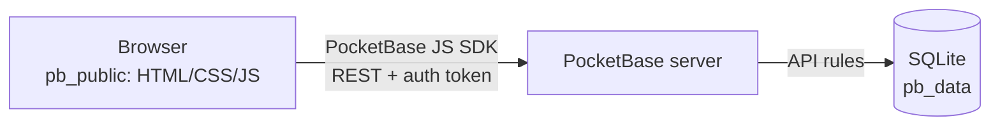

# Student Task Manager

A lightweight task manager for students — assignments, exams and projects with priorities and due dates — built on **PocketBase** with a plain HTML/CSS/JavaScript front end.


## 1. Project Overview

Student Task Manager is a small full-stack web app: students sign up, log in and manage their own list of academic tasks. PocketBase provides the database, authentication and REST API in a single binary, and also serves the front end from `pb_public/`.

## 2. Problem Statement

Students juggle deadlines from several courses at once. Notes apps and paper lists don't distinguish an exam from a homework, don't show what is urgent, and are easy to lose.

## 3. Solution

A focused app with one job: capture every academic task with its **type**, **priority** and **due date**, show what is still open, and keep each student's list private to them.

## 4. Features

- Sign up / log in with email and password (PocketBase auth)
- Create, edit, complete and delete tasks
- Task **type** (Assignment · Exam · Project) and **priority** (Low · Medium · High) with colour coding
- Optional due date and description
- Each user sees **only their own tasks** (enforced server-side by API rules)
- Responsive layout; no build step needed

## 5. Technology Stack

| Layer | Technology |
|---|---|
| Backend, database, auth, REST API | [PocketBase](https://pocketbase.io/) 0.36 (Go + SQLite) |
| Front end | HTML5, CSS3, vanilla JavaScript |
| API client | PocketBase JS SDK |
| Schema management | PocketBase JavaScript migrations (`pb_migrations/`) |

## 6. System Architecture



PocketBase serves the static front end and the API from the same origin. The browser authenticates with `users.authWithPassword()`; every request then carries the auth token and PocketBase evaluates the collection's **API rules** before touching the database.

## 7. Database Design

| Collection | Field | Type | Notes |
|---|---|---|---|
| `users` (auth) | `email`, `password`, `name`, `avatar` | built-in auth | |
| `tasks` | `title` | text | required |
| | `description` | text | |
| | `type` | select | Assignment · Exam · Project |
| | `priority` | select | Low · Medium · High |
| | `due_date` | date | |
| | `is_completed` | bool | |
| | `user` | relation → `users` | owner of the task |

The schema evolves through versioned migrations in `pb_migrations/`; `pb_public/pb_schema.json` is a snapshot that can be imported from the admin UI.

## 8. Security Considerations

| Area | Implementation |
|---|---|
| Authentication | PocketBase auth collection; passwords are hashed by PocketBase |
| Data isolation | `tasks` API rules: list/view/update/delete only where `user = @request.auth.id`; create only for yourself (`@request.body.user = @request.auth.id`); the owner cannot be reassigned |
| Users collection | Users can only read and edit their own record |
| XSS | Task text is HTML-escaped before rendering |
| Secrets & data | `pb_data/` (database, logs) is git-ignored |

> **Fix included:** an earlier version only checked "is logged in", so any user could read or edit everyone's tasks. Migration `1794490000_secure_task_rules.js` restricts every operation to the task owner.

## 9. Screenshots / Demo

Screenshots will be added to `docs/screenshots/`. Run it locally in under a minute (see below).

## 10. Installation & Setup

1. Download PocketBase **0.36.x** for your OS from the [official releases](https://github.com/pocketbase/pocketbase/releases).
2. Put the `pocketbase` binary in the project root (next to `pb_public/` and `pb_migrations/`).
3. Start it — migrations run automatically on start:

```bash
./pocketbase serve
```

4. Open `http://127.0.0.1:8090/_/` once to create the PocketBase admin, then open `http://127.0.0.1:8090/` and sign up.

## 11. Future Improvements

- Filters and sorting (by due date, type, priority) and a "due this week" view
- Reminders before deadlines (email or push)
- Courses / subjects as a separate collection
- Dark mode and Arabic (RTL) interface
- Real-time updates with PocketBase subscriptions

## 12. Project Status

**Complete** — a working rapid-development project demonstrating CRUD, authentication, database integration and server-side access rules with PocketBase.
